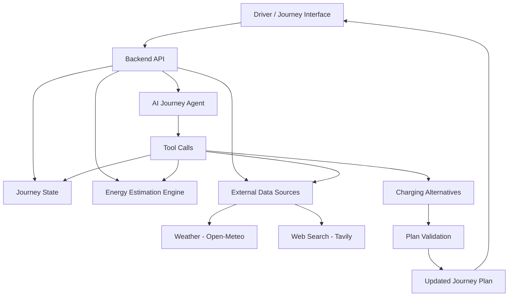

# SpectraX — AI powered EV journeys
# SpectraX 🚗⚡
### Smarter EV Journeys. Autonomous Decisions. Zero Range Anxiety.

**SpectraX** is an AI-powered EV journey intelligence platform designed to help electric vehicle drivers navigate changing road conditions, evaluate charging options, and adapt their journeys when unexpected disruptions occur.

Rather than acting as a conventional navigation dashboard, SpectraX explores how an AI agent can use tools, structured vehicle data, and deterministic engineering logic to support intelligent journey recovery.

> **Core idea:** When a journey stops going to plan, help the driver find a better plan.

---

## 💡 Inspiration

EV journeys involve more than finding the shortest route. Drivers must consider battery state of charge, energy consumption, weather, traffic, and charging infrastructure.

A journey that appears feasible at departure can become challenging when conditions change or a planned charging station becomes unavailable.

SpectraX was created to explore a more adaptive approach: an intelligent travel co-pilot that can evaluate journey conditions, investigate alternatives, and support validated changes to a travel plan.

## ✨ Key Features

- **Intelligent journey planning:** Combines route information with estimated energy requirements and charging constraints.
- **Vehicle-state awareness:** Uses vehicle telemetry or simulated vehicle state to reason about battery charge and journey progress.
- **Weather integration:** Retrieves environmental information through the Open-Meteo API.
- **Charging intelligence:** Evaluates candidate charging stops against journey requirements.
- **AI-assisted decisions:** Uses an LLM-based tool-calling workflow to gather information and support planning decisions.
- **Scenario simulation:** Provides a way to explore disruptions, such as changing journey conditions or charger unavailability.
- **Journey-plan validation:** Applies application-level checks before accepting proposed plan changes.
- **Decision event log:** Makes relevant system events and tool activity easier to inspect.

*Feature availability and live-data coverage depend on the current implementation and configured data sources. Simulated conditions should not be interpreted as verified real-world events.*

## 🧠 How It Works

SpectraX separates AI-assisted reasoning from deterministic engineering calculations.



### Journey workflow

1. **Establish the journey state.** Retrieve the available route, vehicle state, battery information, and relevant journey constraints.
2. **Estimate energy requirements.** Calculate the approximate energy required for the journey or a candidate route segment.
3. **Gather context.** Retrieve relevant weather or other available information.
4. **Evaluate alternatives.** Identify and compare candidate charging stops using structured application data.
5. **Request a plan update.** The AI component can use available tools to support a revised journey plan.
6. **Validate the result.** Application logic checks the proposed update against defined constraints before accepting it.
7. **Present the outcome.** The interface displays the updated journey information and relevant events.

The application is designed so that the language model does not replace deterministic energy calculations or independently execute safety-critical vehicle controls.

## ⚡ Energy Estimation

A basic estimate of journey energy requirements is:

$$
E_{\text{required}} = \frac{D \times C}{100}
$$

Where:

- \(E_{\text{required}}\) = estimated energy required, in kWh
- \(D\) = journey distance, in km
- \(C\) = estimated energy consumption, in kWh per 100 km

This provides a baseline for evaluating route feasibility and charging needs. Real-world consumption varies with speed, elevation, traffic, weather, vehicle load, and auxiliary power usage.

The equation is an estimate, not a guarantee of remaining range or battery performance.

## 🛠️ Technology Stack

| Component | Technology |
|---|---|
| AI model integration | NVIDIA-hosted Nemotron API |
| Backend | Python / FastAPI, where configured in the current project |
| Weather data | Open-Meteo API |
| Web search | Tavily Search API |
| Map interface | Leaflet, with the configured map tile provider |
| Journey logic | Application-level energy estimation and validation |
| Testing | Python test suite, where included |

The exact components and versions should be verified against the repository before submission.

### AI provider note

The current AI integration uses NVIDIA's hosted Nemotron API. 

## 🚀 Getting Started

### Prerequisites

Before running SpectraX, make sure you have:

- Python 3.10 or a compatible version supported by the project
- Git
- An NVIDIA API key for the configured Nemotron endpoint
- A Tavily API key if web search is enabled
- Any additional dependencies specified by the project

### 1. Clone the repository

```bash
git clone https://github.com/YOUR_USERNAME/SpectraX.git
cd SpectraX
```

Replace `YOUR_USERNAME` with your GitHub username and adjust the repository URL if you chose a different name.

### 2. Create a virtual environment

On macOS or Linux:

```bash
python3 -m venv .venv
source .venv/bin/activate
```

### 3. Install dependencies

If the repository contains a `requirements.txt` file:

```bash
pip install -r requirements.txt
```

If the project uses a different dependency manager, follow its included setup instructions instead.

### 4. Configure environment variables

Create a local `.env` file using the project's `.env.example` as a reference.

Example configuration:

```dotenv
NEBIUS_API_KEY=
TAVILY_API_KEY=your_tavily_api_key
```

For the current NVIDIA-hosted integration, configure the provider-specific variables expected by your code. For example, if your implementation reads these names:

```dotenv
NVIDIA_API_KEY=your_nvidia_api_key
NVIDIA_BASE_URL=https://integrate.api.nvidia.com/v1
```

**Important:** These variable names are examples. Use the exact names expected by your application's configuration. Do not put real API keys in `.env.example`, source code, screenshots, or public commits.

### 5. Run the application

Use the startup command documented by the actual project. For a FastAPI application whose entry point is `server.py`, the command may be:

```bash
uvicorn server:app --reload
```

If the application exposes a web interface on a different port or uses a separate frontend development server, follow the corresponding instructions in the repository.

### 6. Run tests

If the project includes a Python test suite:

```bash
pytest -q
```

A passing test suite verifies only the behaviors covered by those tests. Test the complete journey-recovery scenario and configured external integrations separately before relying on the demo.

## 🧪 Demonstration Scenario

A useful SpectraX demonstration is a journey that becomes infeasible or less convenient after conditions change.

1. Start with an initial journey and vehicle state.
2. Introduce a simulated disruption, such as a charger becoming unavailable.
3. Allow the system to inspect alternative charging options.
4. Evaluate the proposed alternative against the application's energy and journey constraints.
5. Display the validated plan update and associated event log.

This scenario demonstrates the intended value of combining structured engineering logic with AI-assisted tool use.

The scenario should be described as a simulation wherever the vehicle state, disruption, or charger availability is simulated.

## 🔐 Security and Reliability

- Keep API keys in environment variables, never in frontend code or public commits.
- Use `.env.example` for placeholder configuration.
- Validate AI-proposed plan updates before applying them.
- Distinguish simulated data from verified live data.
- Handle unavailable external APIs gracefully.
- Do not connect this prototype to safety-critical vehicle controls.
- Review API usage limits, terms, and licensing before deployment.

## 🗺️ Roadmap

- [ ] Complete end-to-end testing of the disruption-to-recovery workflow.
- [ ] Improve route-aware energy estimation.
- [ ] Integrate reliable, appropriately licensed charging-station data.
- [ ] Improve explanations for charger selection and plan changes.
- [ ] Expand automated tests and error handling.
- [ ] Deploy a public demonstration.
- [ ] Investigate the required infrastructure-provider integration for competitions that mandate it.
- [ ] Evaluate the system using real journey data before making real-world reliability claims.

## 🎓 What I Learned

SpectraX explores the engineering challenges of building an AI-assisted application that needs to make useful, constrained decisions.

The project reinforced the importance of structured tools, deterministic calculations, validation, external-data quality, and clear interfaces. It also highlighted a practical lesson: infrastructure access and API onboarding can affect development even when the application architecture is ready to proceed.

The long-term objective is to make EV journey planning more adaptive while keeping decisions understandable and application behavior verifiable.

## 🤝 Contributing

Contributions and suggestions are welcome. If you would like to contribute:

1. Fork the repository.
2. Create a feature branch.
3. Make and test your changes.
4. Open a pull request describing the improvement.

Please do not submit API keys, private credentials, or personal data.

## 📄 License

This project is intended to be released under the **MIT License**, subject to confirming that the project owner has the rights to license all included code and assets.

Add the complete `LICENSE` file to the repository before describing the project as MIT-licensed.

## 👨‍💻 Project

Built as an exploration of agentic AI, electric-vehicle journey intelligence, and adaptive travel planning.

HOW TO RUN:-
Run: `python server.py` → open http://127.0.0.1:8000 (no pip install). Put your NVIDIA and Tavily keys in the included `.env` (hidden file: Cmd+Shift+. in macOS Finder, 'Hidden items' on Windows) and restart, or paste them on the app's System tab (saved only to the local `.env`). Never commit `.env`.

**Flow:** enter From (◎ = my location) and To → route is set → pre-trip check (Open-Meteo weather, 4 Tavily searches, Nemotron briefing; needs the server and keys) → START TRIP → turn-by-turn screen.
- **Real data:** map tiles (Esri/OSM), places (Nominatim), roads and turns (OSRM public server), charger locations (OpenStreetMap/Overpass), weather (Open-Meteo, feeds the energy model), news search (Tavily), LLM replies (NVIDIA Nemotron).
- **Simulated:** battery, traffic, charger availability/price/reliability, reservations, collision. The trip is a simulated drive along the real route (not live GPS following). The Demo Sim panel is for demonstration only.
- **Agent:** server.py runs a bounded tool loop (get_route_weather, tavily_search, estimate_energy, find_chargers, update_journey_plan); plan changes are validated on the server and again in the browser.
- **Nebius:** the hackathon needs Nebius Token Factory — set LLM_BASE_URL, LLM_API_KEY, LLM_MODEL to the Nebius values.
- **Tests:** `python -m unittest discover -s tests`. **License:** not chosen yet (owner to pick an OSI license).
